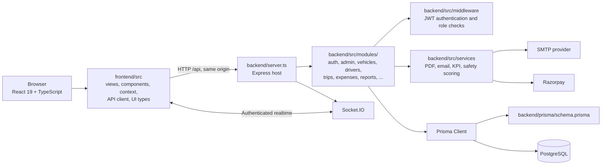

# TransitOps Architecture

## Application components

## Feature module layout

Backend route handlers are grouped by domain under `backend/src/modules/<feature>/`. Shared
authentication middleware, database setup, realtime support, and services remain in common
locations. Prisma is the persistence model and its schema lives in `backend/prisma/`.

## Single-service deployment

The root npm manifest coordinates both folders. Vite builds the frontend into root `dist/`;
`backend/server.ts` serves that static bundle and the API from one Express process. Render's
`render.yaml` uses `npm run build` and `npm start`, with `/api/health` as its database-aware health
check.
