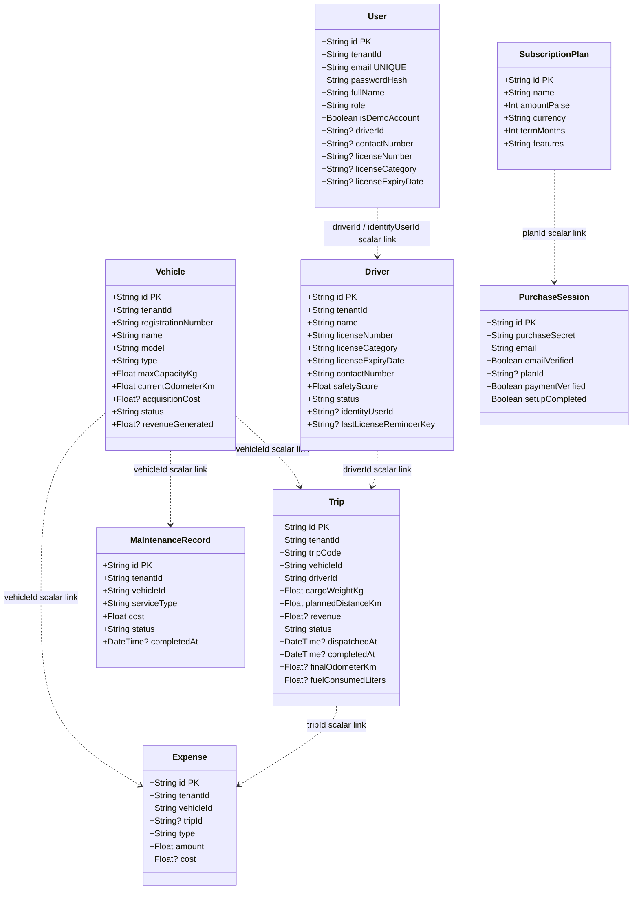

# 3. Current Data Model

The diagram reflects the Prisma models in `backend/prisma/schema.prisma`. IDs that look like
associations are currently scalar fields; most are not declared Prisma relations or database
foreign keys. `tenantId` is the application-level organization boundary.

For field-by-field explanations, including timestamps and snapshot fields, see the database section
of [PROJECT_GUIDE.md](../PROJECT_GUIDE.md).
