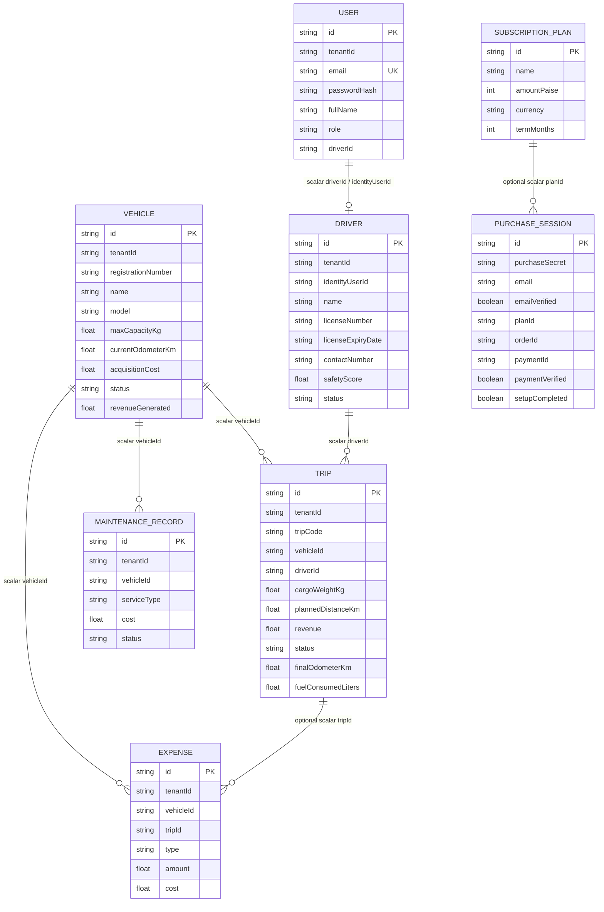

# 4. Entity-Relationship / Data Model

The diagram is based on the current Prisma models in `backend/prisma/schema.prisma`. Most links
below are scalar ID fields checked in application code, not declared Prisma relationships or
database foreign keys. Every operational model is filtered by `tenantId` in the API.

See [PROJECT_GUIDE.md](../PROJECT_GUIDE.md#9-database-schema-every-model-and-field) for the
purpose of every schema field and known schema limitations.
