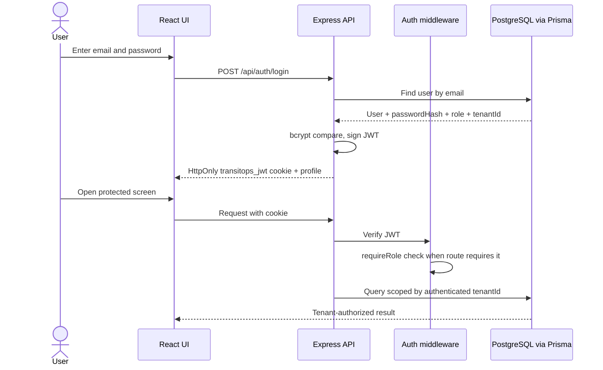
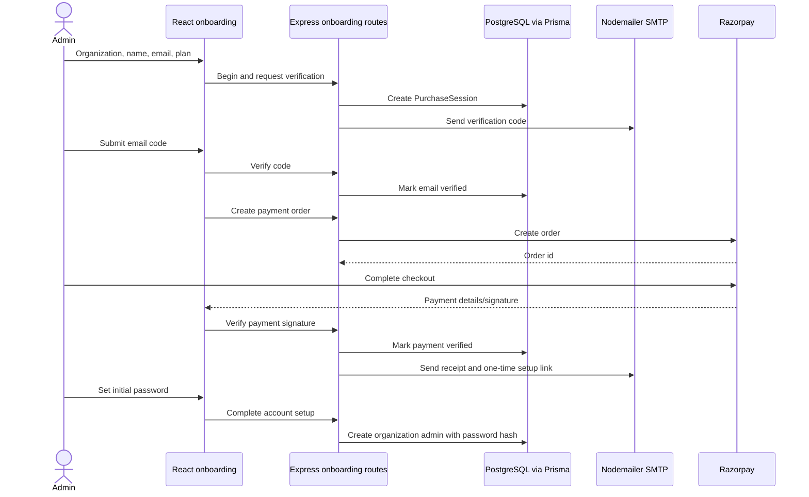
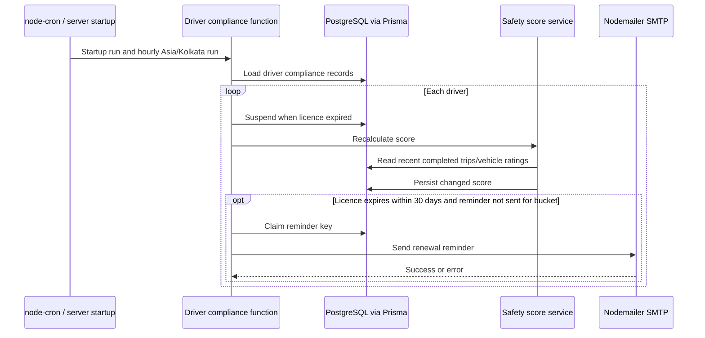

# 6. Current Sequence Diagrams

These diagrams follow the current React, Express, JWT, Prisma, Socket.IO, Nodemailer, PDFKit, and
node-cron implementation.

## 6.1 Login and authenticated request



## 6.2 Draft, dispatch, and driver completion

```mermaid
sequenceDiagram
  actor FM as Fleet Manager
  actor Driver
  participant UI as React clients
  participant API as Express trip routes
  participant DB as PostgreSQL via Prisma
  participant Socket as Socket.IO
  FM->>UI: Create trip draft
  UI->>API: POST /api/trips
  API->>API: Authenticate, check Fleet Manager
  API->>DB: Validate tenant vehicle/driver and save Draft
  DB-->>API: Draft trip
  API-->>UI: 201 trip response
  FM->>UI: Dispatch trip
  UI->>API: POST /api/trips/{id}/dispatch
  API->>DB: Recheck trip, vehicle, driver and licence
  API->>DB: Update trip/vehicle/driver states
  API->>Socket: Emit tenant-scoped status/event
  Socket-->>UI: Update connected same-tenant clients
  Driver->>UI: Complete assigned trip
  UI->>API: POST completion action
  API->>DB: Check linked driver owns dispatched trip; save readings
  API-->>UI: Updated trip
```

## 6.3 Subscription and account setup



## 6.4 Licence compliance job


